# Velorise's Staves

[](https://github.com/velorise2206/velorise-staves/wiki)
[](https://www.curseforge.com/minecraft/mc-mods/velorises-staves-elements)
[](https://modrinth.com/mod/velorises-staves-elements)
<!-- Modrinth Dynamic Downloads Badge (Uncomment once published):
[](https://modrinth.com/mod/velorises-staves-elements)
-->
[](LICENSE)
[](https://minecraft.net/)
[](https://github.com/velorise2206/velorise-staves)

📖 **Full in-depth documentation, crafting guides, and reaction sheets are available on the [Official Velorise's Staves Wiki](https://github.com/velorise2206/velorise-staves/wiki)!**

A lightweight Minecraft magic & combat mod introducing **22 elemental combat staves**, **element-imbued swords**, **8 elemental essence items**, **3 utility artifacts** (including *Wind Glider & Plunge Attack*), **39 custom advancements**, **3D Blockbench models & 8 AFK idle animations**, **character voice-over packs (`[V]`)**, and a complete **Genshin Impact-inspired Elemental Reaction System (EGT)** across **NeoForge 1.21.1**, **Fabric 1.21.1**, and **Forge 1.20.1**.

No complex mana systems, no bloated tiers, and no EMC — just pure, satisfying magic powered by **Vanilla Durability & Cooldowns**, fully enchantable and upgradeable to Netherite.

---

## Showcase

### Combat & Reactions (GIFs)

<table>
  <tr>
    <td align="center" width="50%">
      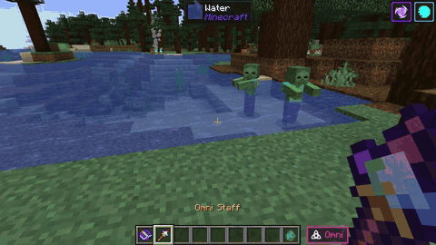<br/>
      <b>Omni Staff</b> — Auto best-reaction &amp; <code>[Tab]</code> Element Wheel
    </td>
    <td align="center" width="50%">
      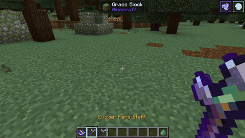<br/>
      <b>Geo Construct &amp; Crystallize</b> — Pillar taunt, Geo waves &amp; 3D Shard
    </td>
  </tr>
  <tr>
    <td align="center" width="50%">
      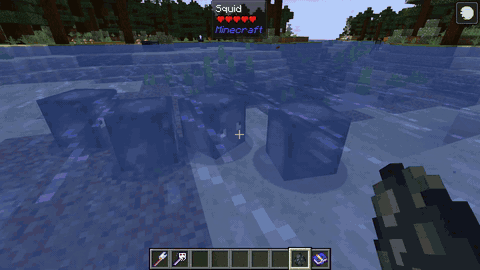<br/>
      <b>Vaporize</b> (Pyro + Hydro) — Ghastfire Staff in water
    </td>
    <td align="center" width="50%">
      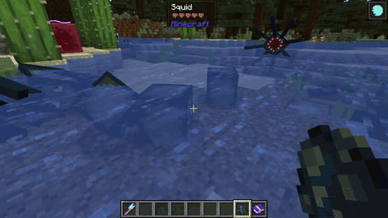<br/>
      <b>Electro-Charged</b> (Hydro + Electro) — Chain shocks in water
    </td>
  </tr>
  <tr>
    <td align="center" width="50%">
      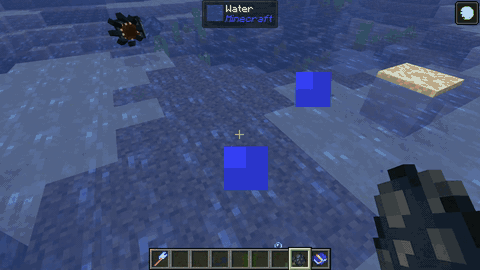<br/>
      <b>Bloom</b> (Hydro + Dendro) — Dendro Core spawn &amp; burst
    </td>
    <td align="center" width="50%">
      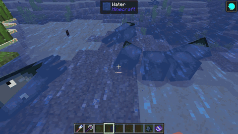<br/>
      <b>Hyperbloom</b> (Bloom + Electro) — Homing seed missiles
    </td>
  </tr>
  <tr>
    <td align="center" width="50%">
      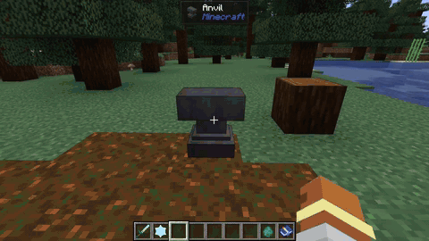<br/>
      <b>Cryo-Imbued Sword</b> — Anvil infuse &amp; Freeze/Melt combo
    </td>
    <td align="center" width="50%">
      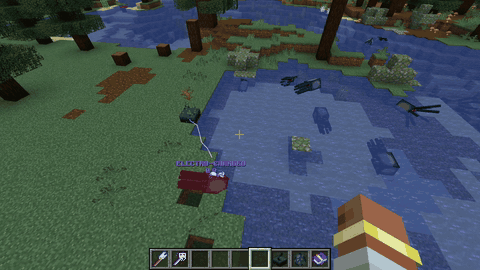<br/>
      <b>Sculk Sensor Hazard</b> — Sound trigger zaps nearby mobs
    </td>
  </tr>
</table>

### UI, Items & Crafting

<table>
  <tr>
    <td align="center" width="50%">
      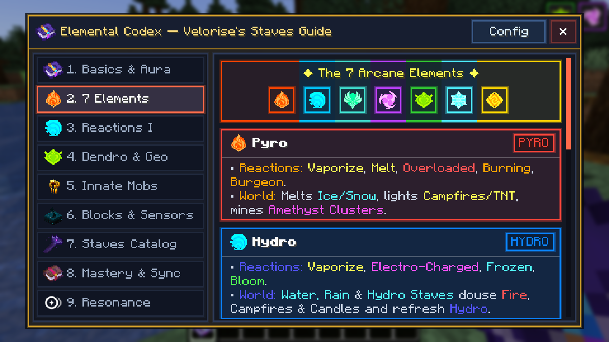<br/>
      <b>Elemental Codex</b> — Interactive 9-tab guidebook &amp; live config
    </td>
    <td align="center" width="50%">
      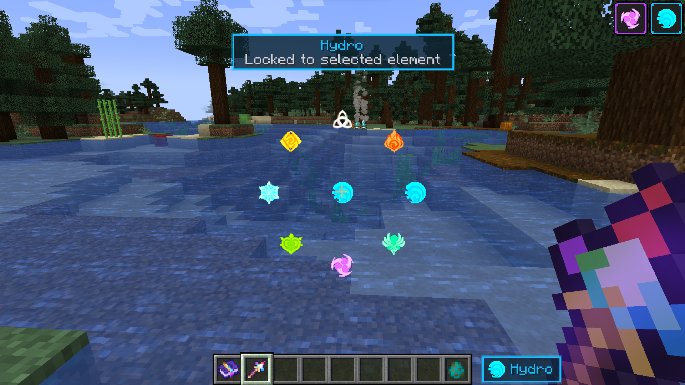<br/>
      <b>Omni Element Wheel</b> — Lock elements or keep Auto Best
    </td>
  </tr>
  <tr>
    <td align="center" width="50%">
      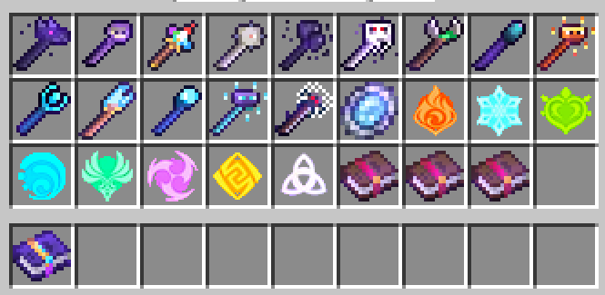<br/>
      <b>Staves &amp; Essences</b> — 22 staves, utility artifacts, elements &amp; books
    </td>
    <td align="center" width="50%">
      <b>Crafting &amp; Upgrades (Text Guide)</b><br/><br/>
      • <b>Omni Element:</b> Combine all 7 Elemental Essences in a Crafting Table.<br/>
      • <b>Omni Staff:</b> Combine 7 Non-Archon Staves (or Trident for Hydro / Void Translocator for Electro) + Diamond/Netherite Sword.<br/>
      • <b>Netherite Tier:</b> Upgrade any Staff in a Smithing Table with a Netherite Upgrade Template + Netherite Ingot (+50% DMG &amp; +50% Gauge U).
    </td>
  </tr>
</table>

---

## Features

### Combat Staves (22 Types + Netherite Upgrades)

#### Basic & Boss Staves + Omni Staff (12)
- **Inferno Rod** (![Pyro][pyro] Pyro): Fires a 3-shot burst of blazing fireballs with a **3rd-Shot Finale** (`+35%` speed, `+50%` DMG, `2.5m` AoE Pyro explosion).
- **Ghastfire Staff** (![Pyro][pyro] Pyro): Launches high-velocity explosive fireballs leaving a 5s **Ghastfire Field** and triggering Amethyst Cluster Overloaded mining.
- **Wither Scepter** (![Dendro][dendro] Dendro): Discharges a 3-skull spread inflicting Wither II & Dendro; **Wither Carapace** grants projectile immunity at `<= 50%` HP, and **Withering Contagion** detonates marked foes on death (`3.0m` Dendro + Wither II cloud).
- **Shulker Seeker** (![Electro][electro] Electro): Left-Click fires a 3-shot homing salvo with **3rd-Shot Gravity Slam** (`2.5m` AoE Electro); Right-Click opens a **Portable Shulker Chest** (`27` Basic / `54` Netherite slots); **Shulker Shell Guard** grants `30%`/`40%` DMG reduction while active.
- **Dragonfire Scepter** (![Electro][electro] Electro): Left-Click hurls a **Plasma Orb** (`4.0s` CD) leaving a lingering **Dragonfire Cloud**; Right-Click toggles a free-flying **Mini Ender Dragon** pet (`30s` duration, no item CD, `0.25s` anti-spam, auto-switches to owner's target and fires snout-aligned lightning arcs every `2.0s`); **`[R]` Burst** (`20.0s` CD) unleashes **Skyfall Dive** (`10×10m`/`12×12m` AoE) when the pet is active or **Sweeping Strafe** (`5×20m`/`6×24m` corridor) otherwise; Passive upgrades *Wind Glider* into a **5m Ender Dragon Glider** (`+50%` glide speed).
- **Evoker Fang Staff** (![Geo][geo] Geo): Erupts a line of evoker fangs and raises a **Geo Fang Pillar** (`1×1×1` Basic / `1×2×1` Netherite, up to 3 active) that taunts enemies, pulses Geo waves, and elevates the caster when cast beneath feet.
- **Arc Caster** (![Electro][electro] Electro): Channels a high-voltage lightning stream that chains across nearby enemies and electrifies water.
- **Frostbolt Wand** (![Cryo][cryo] Cryo): Fires frost bursts inflicting deep freeze & slowness with a **3rd-Shot Permafrost Nova** finale.
- **Webcaster** (![Dendro][dendro] Dendro): Traps enemies in temporary toxic cobwebs that dissolve automatically.
- **Wind Staff** (![Anemo][anemo] Anemo): Fires gusting wind charges that trigger rapid Swirl reactions (backported to Forge 1.20.1 using custom Breeze Rods & Wind Charges crafted from Anemo Essence).
- **Resonant Echo** (![Anemo][anemo] Anemo): Releases a piercing Warden sonic boom through blocks, reducing cooldown by `-1.0s` per valid target hit (up to `-5.0s`).
- **Omni Staff** (![Omni][omni] Omni): Fires prism crystal orbs that automatically trigger the strongest reaction element, or hold `[Tab]` to open the Element Wheel and lock onto any element (can absorb non-Archon staves, Trident, or Void Translocator).

#### Genshin Weapons (3)
- **Guardian Lens** (![Hydro][hydro] Hydro): Neuvillette's Hydro catalyst — Quick-tap fires a **Hydro Orb** (`1♥`, `2.0s` CD), or Hold 3s (instant with **Sourcewater Droplets**) to unleash a piercing 3.0s *Equitable Judgment* Hydro beam scaling with Max HP & Past Draconic Glories (`6.0s` CD, stops self-HP drain at `<= 50%` Max HP).
- **Nights of Formal Focus** (![Cryo][cryo] Cryo): Layla's Cryo staff (crafted with **Frost Rod**) — Grants a **12s Curtain of Slumber Cryo Shield** (`40%` Basic / `60%` Netherite Max HP, `250%` Cryo Absorb) + AoE Cryo, accumulating orbiting **Night Stars** inside the shield to launch 4 homing **Shooting Stars** at 4 stacks.
- **Peak Patrol Song** (![Geo][geo] Geo): Xilonen's Geo sword — Right-Click (`7s` CD) activates 3D Roller Skate Nightsoul (`+35%` speed, wall-climbing, 360° front-flip jump); 2 kicks trigger **Source Samples** (`15s`, `-36%` Elemental RES shred within `8m`, `+90` Fighting Spirit to Mavuika). **`[R]` Ocelotlicue Point!** deals AoE Geo & heals for `12s`.

#### 7 Archon Weapons (7)
- **The Daybreak Chronicles** (![Anemo][anemo] Anemo): Venti's Anemo bow — Tap Left-Click for wind shots, Hold for 3-stage gale arrow (`0.45x➔1.45x` AoE + wind-jump; Netherite C1 fires 2 extra side bolts). Right-Click (`2s` CD) casts **Skyward Sonnet** (`5.0m` Swirl + updraft). **`[R]` Wind's Grand Ode** (`15s` CD, `2.0s` I-frames) fires **Stormeye Vortex** (`8s`, `8m➔12m` pull & elemental absorption).
- **Vortex Vanquisher** (![Geo][geo] Geo): Zhongli's Geo polearm — Tap Right-Click (`4s` CD) to summon a 3.5m **Stone Stele** (`30s`, max 3 Geo Constructs, `4m` pulse); Hold 1.5s (`12s` CD) for **Jade Shield** (`20s`, `150%` absorption, knockback immunity, `-20%` All RES shred within `6m`). **`[R]` Planet Befall** (`12s` CD, `2.5s` I-frames) drops a Geo meteor (`6.0m➔8.5m` AoE) that **Petrifies** enemies (`4.0s➔5.0s`).
- **Engulfing Lightning** (![Electro][electro] Electro): Raiden Shogun's Electro polearm — Hold Left-Click for upward crescent sweep (`1.35x` DMG, `7.5m➔9.5m`). Right-Click (`10s` CD) opens **Eye of Stormy Judgment** (`15s`, `0.9s` coordinated strikes, builds up to 60 Resolve). **`[R]` Secret Art: Musou Shinsetsu** (`18s` CD, `1.6s` I-frames) manifests the 3D **Narukami Robot**, unleashing **Musou no Hitotachi** (`6m➔9m`, up to `2.5x`) and **Musou Isshin** (`7s` 5-step Tachi combo).
- **A Thousand Floating Dreams** (![Dendro][dendro] Dendro): Nahida's Dendro catalyst — Tap Left-Click for 4-step hopscotch combo; Hold Left-Click weaves a `3×3×3m` Dendro cube. Tap Right-Click (`5s` CD) sweeps within `2m`; Hold Right-Click (`6s` CD) opens **Camera Viewfinder** (`20m➔28m`) to mark up to 8 targets with **Seeds of Skandha** (`25s`, **Tri-Karma Purification**) & harvest crops/items. **`[R]` Illusory Heart** (`13.5s` CD, `2.0s` I-frames) expands the 3D **Shrine of Maya** (`15s➔23s`, `18m➔22.5m`, `+1➔+2 EM` & Pyro/Electro/Hydro buffs).
- **Splendor of Tranquil Waters** (![Hydro][hydro] Hydro): Furina's dual-stance (`Ousia` / `Pneuma`, Hold Left-Click to switch) scepter — Skill E (`20s` CD, `30s` duration) summons **Salon Solitaire** (3 Hydro companions) or **Singer of Many Waters** (`1.0❤`/2s heal) while granting **Water Walking**. **`[R]` Let the People Rejoice** (`15s` CD, `1.8s` I-frames) activates **Universal Revelry** (18s Fanfare DMG & Healing bonus).
- **A Thousand Blazing Suns** (![Pyro][pyro] Pyro): Mavuika's Pyro claymore — Tap Right-Click (`15s` CD) for the **Ring of Searing Radiance** (12s Pyro strikes every 2s); Hold or re-press to mount the 3D **Flamestrider** motorcycle (cliff-climbing, water/lava gliding, 5-hit combo, Genshin-authentic `CCD CD F` Donut Spin & Dash Cancel combos with I-frames). **`[R]` Hour of Burning Skies** (`18s` CD, `1.7s` I-frames) consumes Fighting Spirit for **Sunfell Slice** (`5.0❤➔10.0❤` AoE Pyro) + 7s Crucible buff.
- **Silver Dawn** (![Cryo][cryo] Cryo): Tsaritsa's dual-stance (`Bow ⇄ Spear`, Right-Click `6.0s` CD) Cryo regalia — 3-stage Frostflake Arrows / 3-step Spear cleave with passive water freezing, **Rime-Pillar** (`12s`, `4.5m➔6.0m`), 3D **Ice Throne** idle, and dual-variant **`[R]` Elemental Burst** (`15s` CD: Bow **Support Burst** with *Azure Crown* & *Stellar Cryo Reactions*, or Spear **DPS Burst** with Colossal Ice Spear, 10s staff seal & *3 Stellar Punishment* orbital spears).

*All staves can be upgraded to Netherite via the Smithing Table for **1.5x combat stats (damage, HP scaling, elemental gauge U, and effect durations)** and extended range (without reducing cooldowns), and scale with the custom **Elemental Mastery I–III** enchantment.*

> [!NOTE]
> **Full 1.20.1 & 1.21.1 Parity:** All **22 combat staves** are playable on NeoForge 1.21.1, Fabric 1.21.1, and Forge 1.20.1 (`1.20.1` includes custom throwable Wind Charges, Breeze Rods crafted from `anemo_element`, and Frost Rods crafted from `cryo_element` + `breeze_rod`).

### Elemental Essences, Anvil Repair & Imbued Swords

- **8 Elemental Essences** (`pyro_element`..`geo_element`, `omni_element`): Dropped at fixed player-kill hostile rates with **no Looting scaling** (`5%` Natural Innate, `15%` Mutated, `25%` Omni Mutated). Combine all 7 into `omni_element`, repair matching Staves (`omni_element` repairs all), replace Lightning Rod in `arc_caster`, convert Anemo into Wind Charges / Breeze Rods, or upgrade any Staff + `omni_element` directly to **Omni Staff** keeping Enchantments & Netherite tier.
- **Imbued Swords**: Combine any `SwordItem` with an Element in an **Anvil** keeping Enchantments & Netherite tier. Full-strength swings (`>= 90%` charge) apply `1.0U` and amplify sword damage via EGT reactions (excluded from Elemental Resonance and the 4-Staff Cap).

### Utility Artifacts, Voice-Over, Advancements & Codex

- **Void Translocator**: Blink forward up to 24 blocks (36 Netherite) through solid obstacles safely.
- **Magic Mirror**: Channel to recall back to your bed or world spawn point (cross-dimensional on Netherite).
- **Wind Glider (Wings of First Flight)**: Press `[Space]` in mid-air while falling to deploy your glider, or Left-Click mid-air to perform a **Plunge Attack** (canceling 100% of fall damage); carrying *Dragonfire Scepter* upgrades it into a **5m Ender Dragon Glider** (`+50%` glide speed).
- **Character Voice-Over (`[V]`)**: Built-in voice-over configuration screen supporting per-character language slots (`EN`, `CN`, `JP`, `KR`) and custom Resource Pack voice overrides.
- **Elemental Codex**: Interactive in-game guidebook with highlighted keywords, clickable reaction/staff links, heart-rendered damage stats, live server config sync, and **9-language** localization (`en_us`, `vi_vn`, `zh_cn`, `ja_jp`, `ko_kr`, `de_de`, `es_es`, `fr_fr`, `ru_ru`).
- **Advancements Tab (39 Advancements)**: Dedicated advancement tree covering weapon crafting, Netherite smithing, Elemental Mastery, Omni Staff, EGT reactions, Dendro Cores, Crystallize shields, Geo Fang Pillars, Tesla Coils, spatial artifacts, and hidden elemental challenges.

---

## Elemental Reaction System (EGT)

Built upon **Elemental Gauge Theory**, attacks and the environment apply elemental auras with decay, internal cooldowns (ICD), and reactions:

- **7 Elements** (+ ![Omni][omni] **Omni**): Pyro ![Pyro][pyro], Hydro ![Hydro][hydro], Cryo ![Cryo][cryo], Electro ![Electro][electro], Anemo ![Anemo][anemo], Geo ![Geo][geo], Dendro ![Dendro][dendro].
- **Core Reactions**:
  - **Vaporize** (![Hydro][hydro] + ![Pyro][pyro]) & **Melt** (![Pyro][pyro] + ![Cryo][cryo]) — Multiplicative damage scaling.
  - **Overloaded** (![Pyro][pyro] + ![Electro][electro]) — High-knockback AOE explosion.
  - **Frozen & Shatter** (![Hydro][hydro] + ![Cryo][cryo], then ![Geo][geo]/Heavy) — Locks enemies in ice, then shatters for heavy damage.
  - **Electro-Charged** (![Hydro][hydro] + ![Electro][electro]) — Continuous chain lightning shock.
  - **Burning** (![Pyro][pyro] + ![Dendro][dendro]) — Rapid continuous flame ticks.
  - **Quicken, Aggravate & Spread** (![Dendro][dendro] + ![Electro][electro]) — Flat elemental damage amplification.
  - **Bloom, Hyperbloom & Burgeon** (![Hydro][hydro] + ![Dendro][dendro], then ![Electro][electro]/![Pyro][pyro]) — Spawns 3D physical Dendro Cores that burst or home into enemies.
  - **Swirl** (![Anemo][anemo] + Aura) — Spreads absorbed elements in an expanding gale.
  - **Crystallize** (![Geo][geo] + Aura) — Drops 3D elemental crystal shards providing player shields and 250% matching resistance.

### World & Creature Interactions

- **Innate Creature Elements & 7% Mutation (6% Elemental + 1% Omni Mutated)**: Nether mobs (Blaze, Magma Cube, Piglin) possess Innate Pyro; Strays have Innate Cryo; Guardians have Innate Hydro; Endermen have Innate Electro; Iron Golems have Innate Geo, etc. Normal hostile mobs have a configurable **7% default chance** to spawn mutated: **6%** roll one of the 7 standard elements (immune to their own element), and **1%** become **Omni Mutated** (![Omni][omni] `Omni ∞` — 100% `IMMUNE` to all elemental/reaction damage, vulnerable only to physical attacks, and automatically triggering the strongest elemental reaction against targets with an active Aura or applying a random element when the target has no Aura).
- **Environmental Afflictions & Tesla Coil**: Water & Rain apply Hydro (and Hydro beams extinguish fire/campfires/candles); Lava & Fire apply Pyro; Powder Snow applies Cryo; Cactus & Sweet Berries apply Dendro; Stalactites apply Geo; Thorns armor reflects **0.5U per level** of the target's element back to attackers. Placing a Copper Lightning Rod atop a Redstone Block builds a **Tesla Coil** firing 3–5 Electro arcs every 2s (2x stats during rain or 30s on lightning strike).

---

## Visual & Combat Feedback

- **3D Floating Combat Text**: Reaction titles (`VAPORIZE`, `IMMUNE`, etc.) and elemental damage numbers pop cleanly at torso height.
- **HD Overhead Element Icons**: 32x32 pixel-art icons above mobs displaying active auras, dual-reaction animations, and `Omni` mutation badges.
- **Jade / Waila HUD**: Native tooltip integration showing active element gauges, `Omni ∞`, and remaining durations.

---

## Building from Source

Supports **NeoForge 1.21.1**, **Forge 1.20.1**, and **Fabric 1.21.1**:

```powershell
# Clone repository
git clone https://github.com/velorise2206/velorise-staves.git
cd velorise-staves

# Build all 3 loaders simultaneously
powershell -ExecutionPolicy Bypass -File .\build-all.ps1
```

Compiled jar artifacts will be placed in the `mods/velorise_staves/` directory.

---

## Recommended Companion Mods & Other Works

Enhance your adventure with companion mods by **velorise2206**:

- **[Camera Lock-On](https://github.com/velorise2206/camera-lock-on)** ([CurseForge](https://www.curseforge.com/minecraft/mc-mods/camera-lock-on) / [Modrinth](https://modrinth.com/mod/velorise-camera-lock-on)): Adds a third-person Zelda/Souls-style target locking system. **Highly recommended** for *Velorise's Staves* to aim projectile spells, circle-strafe swift elemental foes, and pull off clean combat combos!
- **[Velorise Simple Map](https://github.com/velorise2206/Simple-Map)** ([CurseForge](https://www.curseforge.com/minecraft/mc-mods/velorise-simple-map) / [Modrinth](https://modrinth.com/mod/velorise-simple-map)): A sleek, lightweight, clutter-free minimap and world map mod optimized for smooth exploration and waypoint navigation.

---

## License & Disclaimer

Copyright (c) 2026 **velorise2206** — **MIT (Code & Documentation Only)** ([LICENSE](LICENSE)).

- **Scope of License (Excluding Assets):** The **MIT** license applies solely to this mod's original source code, compiled binaries, data/localization files, and documentation authored by **velorise2206**. You may NOT copy, redistribute, reupload, modify, or create derivative works from this mod's source code or binaries without prior written permission from the copyright holder. It does **not** cover or claim exclusive ownership over visual assets, element icons, textures, or 3D models.
- **Third-Party IP Disclaimer:** *Velorise's Staves* is an **unofficial, non-commercial fan-made mod** inspired by *Genshin Impact* and is **not affiliated with, endorsed by, or associated with HoYoverse / Cognosphere Pte. Ltd.** (or Mojang / Microsoft). All *Genshin Impact* trademarks, names, element icons/symbols, and related IP belong to **HoYoverse / Cognosphere Pte. Ltd.**; any third-party fan textures or 3D models belong to their respective creators.

[pyro]: shared-resources/assets/velorise_staves/textures/element/pyro.png
[hydro]: shared-resources/assets/velorise_staves/textures/element/hydro.png
[cryo]: shared-resources/assets/velorise_staves/textures/element/cryo.png
[electro]: shared-resources/assets/velorise_staves/textures/element/electro.png
[anemo]: shared-resources/assets/velorise_staves/textures/element/anemo.png
[geo]: shared-resources/assets/velorise_staves/textures/element/geo.png
[dendro]: shared-resources/assets/velorise_staves/textures/element/dendro.png
[omni]: shared-resources/assets/velorise_staves/textures/element/omni.png
