# Relics & Utility Artifacts

In addition to offensive combat staves, **Velorise's Staves & Elements** provides utility artifacts designed to streamline exploration, navigation, and defensive survival.

---

## Magic Mirror

  
  &nbsp;&nbsp;&nbsp;&nbsp;&nbsp;&nbsp;
  
   
  <b>Magic Mirror (Basic) &nbsp;|&nbsp; Netherite Magic Mirror (Ascended)</b>

* **Primary Function:** Provides an instantaneous recall mechanic back to your bed or world spawn point.
  * Hold **Right-Click** for 2.5 seconds (or 1.0s for Netherite) to channel recall energy.
  * Transports the player directly to their established spawn point, accompanied by custom audio cues and portal particle spirals.
* **Durability & Repair:**
  * **Basic Tier:** 40 uses. Repaired at an anvil using Echo Shards (or Diamonds). Recalls within the current dimension.
  * **Netherite Tier:** 150 uses. Repaired using Netherite Ingots. Enables cross-dimensional teleportation (teleporting from the Nether or The End directly back to your Overworld spawn bed).
* **Crafting Recipe:**
  * Shaped: 1 Ender Pearl (center), 4 Diamonds (cross), 2 Glass (corners).

  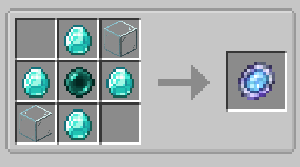
    
  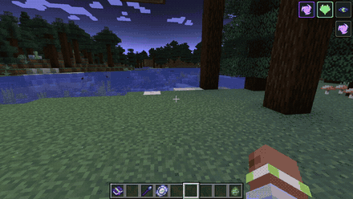
   <i>Channeling the Magic Mirror to recall instantly back to your spawn bed.</i>

---

## Void Translocator

  
  &nbsp;&nbsp;&nbsp;&nbsp;&nbsp;&nbsp;
  
   
  <b>Void Translocator (Basic) &nbsp;|&nbsp; Netherite Void Translocator (Ascended)</b>

* **Primary Function:** An instantaneous directional blink teleportation tool.
  * Right-click while looking forward to blink instantly to the targeted block surface in your line of sight.
  * **Basic Tier:** 24.0 block reach, 80 durability.
  * **Netherite Tier:** 36.0 block reach, 250 durability.
  * **Cooldown:** 5.0 seconds.
* **Mechanics:**
  * Resets fall distance to 0, ensuring **zero fall damage** upon landing.
  * Self-inflicts a lingering Electro charge on the caster (1.0U Basic / 1.5U Netherite) upon blink discharge.
* **Crafting Recipe:**
  * Shaped (3x3 Diagonal): 1 Ender Pearl (Top-Right) + 1 Electro Element (Center) + 1 Blaze Rod (Bottom-Left).

> [!WARNING]
> ### ⚡ Critical Hazard: Self-Applied Electro Aura
> Blinking with the Void Translocator instantly discharges volatile dimensional static onto the caster, applying a **1.0U Electro Aura (Basic)** or **1.5U Electro Aura (Netherite)**!
> 
> **Exercise extreme caution during combat and environmental exploration:**
> * 🌊 **In Water or Rain:** Blinking while wet or standing in rain immediately triggers self-inflicted [**Electro-Charged**](Elements-and-Reactions#electro-charged), dealing continuous electrical damage ticks to yourself and causing heavy screen shake!
> * 🔥 **Burning or Fighting Pyro Mobs (Blazes, Ghasts):** Blinking while ignited or struck by Pyro projectiles instantly detonates an [**Overloaded**](Elements-and-Reactions#overloaded) blast directly centered on your player, dealing explosive recoil damage and knocking you backward!
> * ❄️ **Fighting Cryo Enemies (Strays):** Carrying the self-inflicted Electro charge while struck by Cryo triggers [**Superconduct**](Elements-and-Reactions#superconduct), shredding your own physical defense by **-40%**!
> * 🌿 **Afflicted by Dendro:** Blinking while carrying a Dendro aura places you into the [**Quicken**](Elements-and-Reactions#quicken) state, amplifying incoming Dendro and Electro damage significantly!

  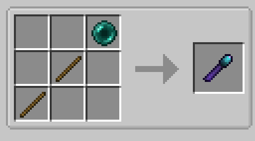
    
  <table>
    <tr>
      <td align="center"><b>Safe Blink & Zero Fall Damage</b> 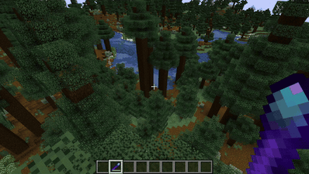</td>
      <td align="center"><b>Self-Applied Electro Aura (HUD / Inventory)</b> 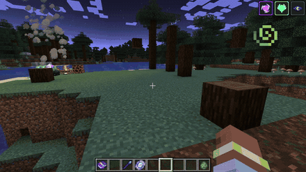</td>
    </tr>
  </table>
   <i>Blinking across terrain instantaneously resets fall distance, but charges the player with 1.0U Electro.</i>

---

## Elemental Codex

  

* **Crafting Recipe:** **1 Book + 1 Amethyst Shard** placed anywhere in a Crafting Table (shapeless recipe).
* **In-Game Feature:** Right-clicking opens an illuminated in-game reference codex displaying the full elemental wheel, active reaction multipliers, and craftable recipes without requiring players to consult external web browsers.

  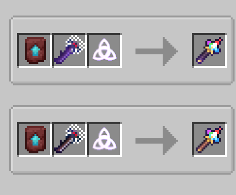
    
  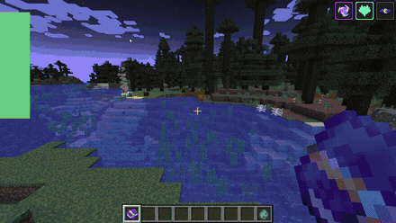
   <i>Browsing the in-game illuminated Codex with reaction formulas and staff details.</i>

---

## Omni Element

  

* **Primary Function:** The ultimate catalyst used in Smithing Table transformations to synthesize the [Omni Staff](Staves-List#the-apex-weapon-omni-staff) or repair any elemental weapon.
* **Crafting Recipe:** Combine all **7 Elemental Essences** (Pyro, Hydro, Cryo, Electro, Dendro, Anemo, Geo) in any Crafting Table (shapeless recipe).

  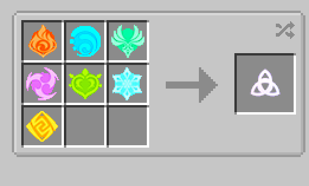

---

## Crystallize Shield Shards

  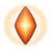
  
  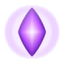
  
    
  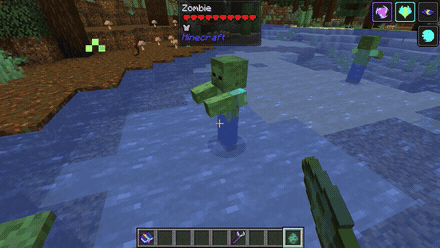

* **Shard Generation & Lifetime:** Produced whenever a **[Geo](Elements-and-Reactions#the-7-elements--omni)** attack strikes an entity afflicted with **[Pyro](Elements-and-Reactions#the-7-elements--omni)**, **[Hydro](Elements-and-Reactions#the-7-elements--omni)**, **[Electro](Elements-and-Reactions#the-7-elements--omni)**, or **[Cryo](Elements-and-Reactions#the-7-elements--omni)** (including **Shatter-Crystallize** when a Geo hit triggers [**Shatter**](Elements-and-Reactions#shatter) on a [**Frozen**](Elements-and-Reactions#frozen) target that preserves an underlying Hydro or Cryo aura). Shards pop upward and linger for **17.5 seconds (`350 ticks`)**, governed by a **1.0s (`20 ticks`)** reaction ICD and a **3.0s (`60 ticks`)** per-mob shard spawn cooldown.
* **Golden Heart Absorption Shield (`15s`):** Walking within **1.5m** of a dropped shard equips an orbiting elemental crystal shield for **15 seconds (`300 ticks`)** and grants **`2.0 HP` (`1.0 ♥` Golden Absorption Heart)** base shield capacity:
  * **Elemental Mastery Scaling:** Each level of [**Elemental Mastery I–III**](Staves-List#staff-enchantments-elemental-mastery) adds **`+1.0 HP` (`+0.5 ♥`)** to the shield (`2.0 / 3.0 / 4.0 / 5.0 HP` from EM 0 to EM III).
  * **Geo Resonance Bonus:** Active [**Geo: Enduring Rock**](Elements-and-Reactions#elemental-resonance-system-all-8-resonances) resonance multiplies [Crystallize](Elements-and-Reactions#crystallize) Shield HP by **`+15%` (`1.15x`)**, while granting **+15% Elemental & Physical Damage** and **-20% Geo RES Shred** (`15s`) while shielded.
  * **Shield Break Rule:** If your Golden Absorption Hearts are depleted (`<= 0 HP`), the elemental shield shatters immediately.
* **250% Matching Elemental Absorption Efficiency (`-60%` Damage Taken):** Faithful to *Genshin Impact*, all 4 [**Crystallize**](Elements-and-Reactions#crystallize) shields absorb all incoming damage via Golden Absorption Hearts, and grant **250% absorption efficiency (`0.4x` incoming damage multiplier — reducing damage taken by 60%)** against attacks, reactions, innate/mutated mobs, and environmental hazards matching the shield's element:
  * 🔥 **Pyro Shard:** Reduces incoming **[Pyro](Elements-and-Reactions#the-7-elements--omni)** spell/mob attacks, [**Overloaded**](Elements-and-Reactions#overloaded), [**Burning**](Elements-and-Reactions#burning), and [**Burgeon**](Elements-and-Reactions#burgeon) reaction damage, fire/lava (`IS_FIRE`), and firework blasts (`FIREWORKS`) by **60%**. *(Walking within `1.6m` of a [**Dendro Core**](Elements-and-Reactions#dendro-reaction-system-bloom--catalyze) while protected by a Pyro Shield also triggers [**Burgeon**](Elements-and-Reactions#burgeon)!)*
  * 💧 **Hydro Shard:** Reduces incoming **[Hydro](Elements-and-Reactions#the-7-elements--omni)** spell/mob attacks, drowning damage (`IS_DROWNING`), and melee/thrown **[Vanilla Trident](Elements-and-Reactions#2-vanilla-trident-wind-burst-mace--thorns-armor)** strikes by **60%**.
  * ⚡ **Electro Shard:** Reduces incoming **[Electro](Elements-and-Reactions#the-7-elements--omni)** spell/mob attacks, [**Electro-Charged**](Elements-and-Reactions#electro-charged) shocks, lightning strikes (`IS_LIGHTNING`), and Dragon's Breath (`DRAGON_BREATH`) by **60%**. *(Walking within `1.6m` of a [**Dendro Core**](Elements-and-Reactions#dendro-reaction-system-bloom--catalyze) while protected by an Electro Shield also triggers [**Hyperbloom**](Elements-and-Reactions#hyperbloom)!)*
  * ❄️ **Cryo Shard:** Reduces incoming **[Cryo](Elements-and-Reactions#the-7-elements--omni)** spell/mob attacks, [**Superconduct**](Elements-and-Reactions#superconduct) AoE blasts, and freezing hazard damage (`IS_FREEZING` such as Powder Snow) by **60%**.

---

## Wind Glider (Wings of Companionship) & Universal Plunge Attack

  
   
  <b>Wind Glider (Permanent Account/Player Unlock — Zero Equipment Slot)</b>

* **Permanent Unlock (Zero Armor Slot Required):**
  * **Right-Click** while holding the **Wind Glider** to consume it once and **permanently unlock gliding** on your character (persists across death and respawn, keeping your Chestplate slot 100% free for full armor!).
  * **Mid-Air Deployment:** Press **`[Spacebar]` while falling in mid-air** to unfurl **2 symmetrical 3D Anemo feather wing planes (`64×32` transparent `wind_glider.png` compatible with vanilla `elytra.png` UV)** while keeping your character in a **standing upright gliding pose**. Press **`[Spacebar]`** again to fold the wings away.
  * **Flight & Updraft Synergy:** Smoothly slows descent (`0` fall damage) and **ascends rapidly when gliding over Venti's *Wind's Grand Ode* stormeye updrafts**!
* **Universal Plunge Attack (Sword / Polearm / Staff):**
  * Press **Left-Click (Attack) while in mid-air** (or while gliding with the Wind Glider) with any **Sword** or **Arcane Staff** to fold your wings and dive straight down in a two-handed downward weapon plunge!
  * **Genshin-Standard Fall Damage Reduction:** Plunges from **`<= 15` blocks deal `0` fall damage (100% immunity)**; plunges from **`> 15` blocks reduce fall damage by 50% and are hard-capped at `40%` Max HP** (never fatal).
  * **Ground Impact AoE:** Unleashes a **`3.5m` elemental/melee shockwave** upon touchdown (`3.25♥` Basic / `4.5♥` Netherite + active staff or imbued sword element).
* **Crafting Recipe (Mid-Game):**
  * Shaped (3x3): **2 Phantom Membranes** (top corners) + **1 Diamond** (top center) + **1 Gold Ingot** (center) + **4 Feathers** (sides & bottom corners).

  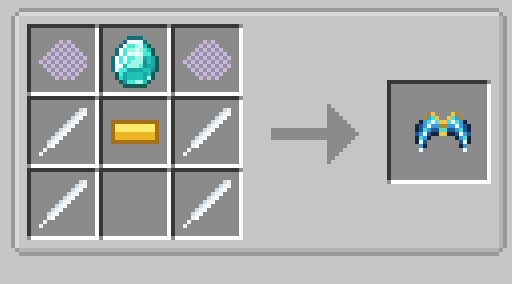

---

## Elemental Crafting Rods (Frost Rod, Hydro Rod & Geo Rod)

  
  &nbsp;&nbsp;&nbsp;&nbsp;
  
  &nbsp;&nbsp;&nbsp;&nbsp;
  
   
  <b>Frost Rod &nbsp;|&nbsp; Hydro Rod &nbsp;|&nbsp; Geo Rod</b>

* **Obtaining & Shapeless Conversion:**
  * **Mob Drops:** Dropped alongside Elemental Essences by **Strays** (`Frost Rod`), **Guardians / Elder Guardians / Drowned** (`Hydro Rod`), and **Geo-Innate / Mutated Mobs** (`Geo Rod`).
  * **Shapeless Crafting Conversion:** Combine any elemental rod (`Blaze Rod`, `Breeze Rod`, `Frost Rod`, `Hydro Rod`, or `Geo Rod`) with **1 matching Elemental Essence** (`Pyro`, `Anemo`, `Cryo`, `Hydro`, or `Geo`) in a Crafting Table to transfigure it into the corresponding rod!
  * **Used In:** Crafting & repairing **Frostbolt Wand**, **Key of Khaj-Nisut**, **Splendor of Tranquil Waters**, **Vortex Vanquisher**, and **Peak Patrol Song**.

  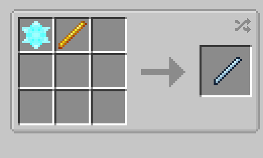
  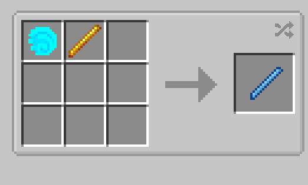
  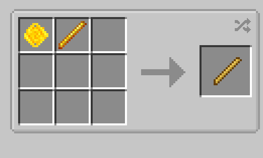

