# Arcane Staves & Netherite Upgrades

**Velorise's Staves & Elements** features 20 distinct elemental staves & Archon weapons, each channeling the power of iconic Minecraft entities and materials. Every basic staff can be upgraded at a **Smithing Table** using a **Netherite Upgrade Template** and a **Netherite Ingot** to grant dramatically increased durability, enhanced reach, **1.5x combat stats (damage, HP scaling, elemental gauge U, and effect durations) without reducing cooldowns**, and immunity to fire and lava destruction.

---

## The Apex Weapon: Omni Staff

<div align="center">
  
  &nbsp;&nbsp;&nbsp;&nbsp;&nbsp;&nbsp;
  
  <br/>
  <b>Omni Staff (Basic Tier) &nbsp;|&nbsp; Netherite Omni Staff (Ascended Tier)</b>
</div>

* **Elemental Alignment:**  Dynamic Omni + Full 7-Element Skill Delegation.
* **Core Mechanics:**
  * **8-Slot Radial Wheel (`[Tab]`):** Hold **`[Tab]`** to open the 8-sector Radial Wheel (`0 = OMNI`, `1..7 = Pyro, Hydro, Cryo, Electro, Dendro, Anemo, Geo`), displaying the **exact absorbed staff name and combat stats** for each element!
  * **100% Skill & Cooldown Delegation (Slots 1–7):** Selecting any of the 7 elements delegates **100% of that element's absorbed staff skill, charged attack, and independent per-element cooldown** (for example, absorbed `Peak Patrol Song` activates Roller Skates on Right-Click; absorbed `Guardian Lens` channels *Equitable Judgment* on Hold Left-Click and summons waterfalls on Right-Click; absorbed `Ghastfire Staff` charges explosive Ghastfire fields).
  * **Prismatic AoE Explosion (`OMNI` Mode — Slot 0):** Rotating to the **`OMNI`** slot fires the homing **Omni Prism Orb**, which automatically selects the highest-value elemental reaction (or falls back to physical damage against Omni-Mutated mobs) and **detonates in a `2.5m` (Basic) / `3.0m` (Netherite) rainbow AoE explosion**!
  * **Combined Durability Inheritance:** Stores all 7 absorbed staves in NBT and **inherits the exact sum of all 7 staves' maximum durability** (`~960–3,500` total durability depending on how many Basic vs. Netherite staves were combined).
  * **Local Swap Cooldown (`1.0s`):** Switching hotbar slots to any Arcane Staff applies a local `1.0s` (`20 ticks`) swap cooldown guard.
* **Combat Stats (`OMNI` Prism Orb Mode):**
  * **Range:** 36m (`2.5m` Prismatic AoE Explosion) [Basic] / 48m (`3.0m` Prismatic AoE Explosion) [Netherite]
  * **Damage:** 10.0 Hearts (20 HP) + 2U Active Element [Basic] / 15.0 Hearts (30 HP) + 3U Active Element [Netherite]
  * **Cooldown:** 6.0 seconds (or delegated per-element staff cooldown when locked to an element)
  * **Durability:** Sum of all 7 absorbed staves' max durability (`960–3,500+`)

### Crafting & Netherite Ascension

<div align="center">
  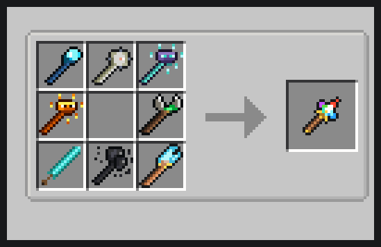
  <br/><sub><i>In-Game 3x3 Shaped Recipe: Combining 7 Non-Archon Elemental Staves (Basic or Netherite) + 1 Diamond Sword in Slot 7.</i></sub>
</div>

<details open>
<summary><b>Step 1: 3×3 Shaped Crafting Table (7 Non-Archon Staves + Diamond Sword)</b></summary>

Arrange **7 Elemental Staves** (excluding the 5 true Archon weapons: *A Thousand Blazing Suns*, *Splendor of Tranquil Waters*, *Engulfing Lightning*, *The Daybreak Chronicles*, and *Vortex Vanquisher*) + **1 `Diamond Sword`** in a 3×3 Crafting Table following the Teyvat map layout:
* **Row 1:** Slot 1 = `Cryo Staff` (`Frostbolt Wand` / `Nights of Formal Focus`) | Slot 2 = `Hydro Staff` (`Guardian Lens`) | Slot 3 = `Anemo Staff` (`Wind Staff` / `Resonant Echo`)
* **Row 2:** Slot 4 = `Pyro Staff` (`Inferno Rod` / `Ghastfire Staff`) | Slot 5 = *Empty* | Slot 6 = `Geo Staff` (`Evoker Fang Staff` / `Peak Patrol Song`)
* **Row 3:** Slot 7 = **`minecraft:diamond_sword`** | Slot 8 = `Dendro Staff` (`Wither Scepter` / `Webcaster`) | Slot 9 = `Electro Staff` (`Arc Caster` / `Dragonfire Scepter` / `Shulker Seeker`)

<div align="center">
  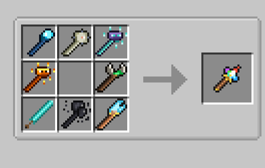
</div>
</details>

<details>
<summary><b>Step 2: Smithing Table Ascension (Netherite Omni Staff)</b></summary>

Upgrade your crafted **Omni Staff** to the **Netherite Omni Staff** at a **Smithing Table** using a **Netherite Upgrade Smithing Template** + **1 Netherite Ingot** (preserving all 7 absorbed staves and upgrading delegated skills to Netherite tier):

<div align="center">
  
</div>
</details>

<br/>

<div align="center">
  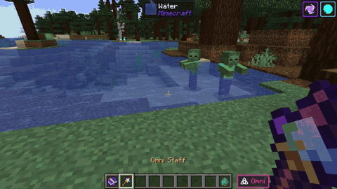
</div>

---

## Electro Staves

| Staff | Element | Base & Netherite Stats | Crafting Recipe & Mechanics |
| :--- | :---: | :--- | :--- |
| <br/><a id="dragonfire-scepter"></a>**Dragonfire Scepter** | <br/>Electro | **Reach:** 32m (3.5m AoE) / 32m (4.5m AoE)<br/>**Damage:** 3.5♥ (7.0 HP) + Cloud + 2U Electro / 5.25♥ (10.5 HP) + Cloud + 3U Electro<br/>**Cooldown:** 8.0s<br/>**Durability:** 130 / 500 | **Recipe:** Shaped (1 Dragon Head + 2 Blaze Rods diagonal).<br/>**Ability:** Hurls dragon breath leaving an electrified cloud that electrifies water and shocks enemies.<br/><br/>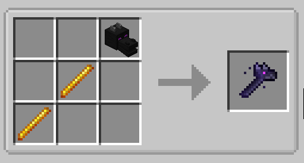 |
| <br/><a id="shulker-seeker"></a>**Shulker Seeker** | <br/>Electro | **Reach:** 30m<br/>**Damage:** 4.0♥ x 2 burst shots + 1U Electro / 6.0♥ x 2 burst shots + 1.5U Electro<br/>**Cooldown:** 5.0s<br/>**Durability:** 130 / 500 | **Recipe:** Shaped (1 Shulker Shell + 2 End Rods diagonal).<br/>**Ability:** Shoots 2 homing Shulker bullets that track moving targets and inflict Levitation (3s / 4s).<br/><br/>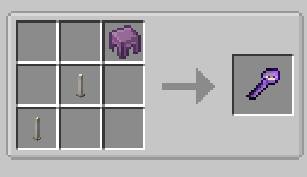 |
| <br/><a id="arc-caster"></a>**Arc Caster** | <br/>Electro | **Reach:** 30m Arc (Single Target) / 36m Arc (6.0m Chain)<br/>**Damage:** 0.5♥ per hit + 1U Electro / 0.75♥ per hit + 1.5U Electro (Channeled, 12 hits)<br/>**Cooldown:** 6.0s<br/>**Durability:** 130 / 500 | **Recipe:** Shaped (1 Electro Element + 2 Amethyst Shards diagonal).<br/>**Ability:** Channeled voltaic arc stream (3.0s). Chains to nearby mobs on Netherite tier.<br/><br/>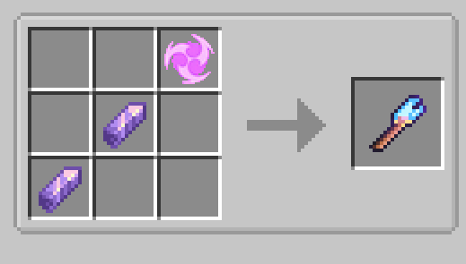 |
| <br/><a id="engulfing-lightning"></a>**Engulfing Lightning** | <br/>Electro | **Reach:** 3.0m➔4.5m Eye (15s) / 6.0m➔9.0m Burst (7s)<br/>**Damage:** 2.0♥ (Eye) / 5.0♥ + Resolve (Musou) / 3.0♥ (Eye) / 7.5♥ + Resolve (Netherite)<br/>**Cooldown:** 10.0s (E) / 18.0s `[R]`<br/>**Durability:** 130 / 500 | **Recipe:** Shaped (3 Electro Elements + 1 Arc Caster + 1 Amethyst Shard).<br/>**Ability (Raiden Shogun):** **Right-Click (E)** summons the **Eye of Stormy Judgment** (`15s`, coordinated Electro AoE slashes on hits + Burst DMG bonus; builds **Chakra Desiderata Resolve** up to 60 stacks when nearby players cast staff skills). **Press `[R]`** (at `>= 30` Resolve) to unleash **Musou no Hitotachi** (`1.5s` I-frames, dimensional screen-crack slash, and `7s` **Musou Isshin** Electro tachi combo that restores allies' staff durability and reduces active cooldowns; Netherite C2 ignores 60% mob defense)!<br/><br/>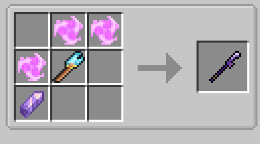 |

---

## Anemo Staves

| Staff | Element | Base & Netherite Stats | Crafting Recipe & Mechanics |
| :--- | :---: | :--- | :--- |
| <br/><a id="resonant-echo"></a>**Resonant Echo** | <br/>Anemo | **Reach:** 28m / 32m<br/>**Damage:** 5.5♥ (11.0 HP) + 2U Anemo ([Swirl](Elements-and-Reactions#swirl)) / 8.25♥ (16.5 HP) + 3U Anemo (Swirl)<br/>**Cooldown:** 8.0s<br/>**Durability:** 130 / 500 | **Recipe:** Shaped (1 Calibrated Sculk Sensor + 2 Echo Shards diagonal).<br/>**Ability:** Charged attack (1.5s charge). Channels a piercing Warden sonic boom that penetrates walls and triggers Swirl.<br/><br/>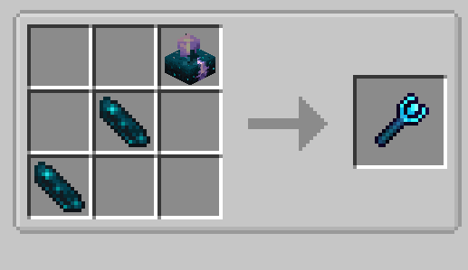 |
| <br/><a id="wind-staff"></a>**Wind Staff** | <br/>Anemo | **Reach:** 28m (3.5m AoE) / 28m (4.5m AoE)<br/>**Damage:** 0.75♥ (1.5 HP) + 1U Anemo ([Swirl](Elements-and-Reactions#swirl)) / 1.125♥ (2.25 HP) + 1.5U Anemo (Swirl)<br/>**Cooldown:** 1.5s<br/>**Durability:** 140 / 500 | **Recipe:** Shaped (1 Wind Charge + 2 Breeze Rods diagonal).<br/>**Ability:** Rapid gust charge. Firing at the ground executes a **Wind-Jump** launch on the caster.<br/><br/>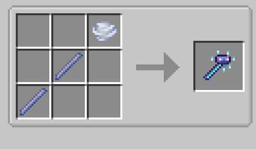 |
| <br/><a id="the-daybreak-chronicles"></a>**The Daybreak Chronicles** | <br/>Anemo | **Reach:** 28m Breeze / 8m➔12m Stormeye Vortex (8s)<br/>**Damage:** 0.75♥ x 1–3 arrows + 1U Anemo / 1.125♥ x 1–3 arrows + 1.5U Anemo<br/>**Cooldown:** 2.0s (Bow) / 15.0s `[R]`<br/>**Durability:** 140 / 500 | **Recipe:** Shaped (4 Anemo Elements + 1 Wind Staff).<br/>**Ability (Venti):** **Hold Right-Click** to draw the bow with 3D nocked wind orb visuals (`_pulling_0/1/2`) and fire piercing Anemo Wind Charges (Netherite C1 splits into 3 arrows). **Hold `[R]` (3.0s)** to unleash **Wind's Grand Ode**, summoning an `8s` Stormeye black-hole vortex that pulls enemies in, absorbs Pyro/Hydro/Electro/Cryo, and generates an **Anemo Updraft** for **Wind Glider** flight & **Universal Plunge Attacks**!<br/><br/>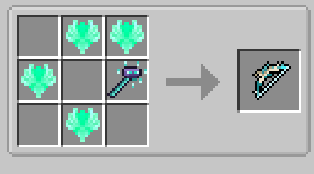 |

---

## Pyro Staves

| Staff | Element | Base & Netherite Stats | Crafting Recipe & Mechanics |
| :--- | :---: | :--- | :--- |
| <br/><a id="inferno-rod"></a>**Inferno Rod** | <br/>Pyro | **Reach:** 30m<br/>**Damage:** 3.0♥ x 3 burst shots + 1U Pyro / 4.5♥ x 3 burst shots + 1.5U Pyro<br/>**Cooldown:** 4.0s<br/>**Durability:** 150 / 550 | **Recipe:** Shaped (1 Fire Charge + 2 Blaze Rods diagonal).<br/>**Ability:** Fires 3 rapid-fire Blaze fireballs sequentially, setting struck entities on fire.<br/><br/>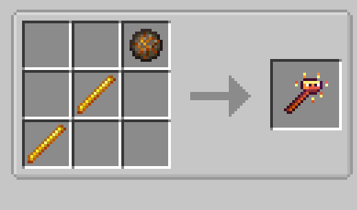 |
| <br/><a id="ghastfire-staff"></a>**Ghastfire Staff** | <br/>Pyro | **Reach:** 36m (3.5m AoE / 5s Field) / 36m (4.5m AoE / 5s Field)<br/>**Damage:** 3.0♥ (6.0 HP) + 2U Pyro / 4.5♥ (9.0 HP) + 3U Pyro<br/>**Cooldown:** 5.0s<br/>**Durability:** 120 / 450 | **Recipe:** Shaped (Slot 3: Pyro Element, Slot 5: Ghast Tear, Slot 7: Blaze Rod).<br/>**Ability:** Charged attack (2.0s charge). Launches an explosive Ghast fireball leaving a 5-second lingering Ghastfire field.<br/><br/>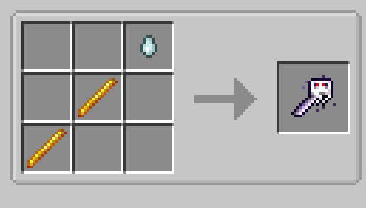 |
| <br/><a id="thousand-blazing-suns"></a>**A Thousand Blazing Suns** | <br/>Pyro | **Reach:** 6m➔8m Sun Ring / 3m Bike / 5m Ulti<br/>**Damage:** 2.0♥–4.0♥ (Spin/Finisher) / 3.0♥–20.0♥ (Netherite Ulti)<br/>**Cooldown:** 15.0s (Dynamic Fuel)<br/>**Durability:** 160 / 520 | **Recipe:** Shaped (1 Pyro Element + 3 Inferno Rods + 1 Netherite Sword).<br/>**Ability (Mavuika):** **Tap Right-Click** summons the **Ring of Searing Radiance** (off-field orbital Pyro strikes every 2s). **Hold Right-Click** (or Tap while Ring is active) mounts the **Flamestrider** motorcycle (automatically equipping a **3D Virtual Pyro Biker Helmet & fiery visor** if the player's helmet slot is empty; hides when a real helmet is worn) with all-terrain climbing, water/cliff flight, 5-hit NA combo, 360° Donut Spin CA + Finisher, and **`[R]` Hour of Burning Skies** (`7s` Crucible of Death and Life with zero Nightsoul drain)!<br/><br/>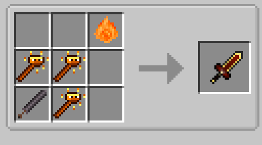 |

---

## Hydro, Cryo & Geo Staves

| Staff | Element | Base & Netherite Stats | Crafting Recipe & Mechanics |
| :--- | :---: | :--- | :--- |
| <br/><a id="guardian-lens"></a>**Guardian Lens** | <br/>Hydro | **Reach:** 24m➔28m (Beam) / 16m (E) / 7m➔9m (`[R]`)<br/>**Damage:** (10%–20% Max HP) x 8 hits (3.0s Beam) / (15%–30% Max HP) x 8 hits (Netherite)<br/>**Cooldown:** `0.0s` (Hold L-Click Beam) \| `12.0s` (Right-Click E) \| `18.0s` (`[R]` Q)<br/>**Durability:** 130 / 500 | **Recipe:** Shaped (Slot 3: Hydro Element, Slot 5: Prismarine Shard, Slot 7: Prismarine Crystals).<br/>**Ability (Neuvillette Separated Controls Rework):**<br/>• **Hold Left-Click (Charged Attack — *Equitable Judgment*, `0s` CD):** Charges for `3.0s` to fire a `3.0s` piercing Hydro beam. Absorbing **Sourcewater Droplets** within `12m` reduces charge time by **`1.0s` per droplet** and heals **`16%` Max HP** (**3 droplets = `0.0s` instant beam!**). Drains 8% Max HP per 0.5s down to 50% Max HP and scales with **Past Draconic Glories** (`1.15x / 1.30x / 1.60x` from Hydro reactions; Netherite C1 grants interruption immunity + 1 base stack).<br/>• **Right-Click (Skill E — *O Tears, I Shall Repay*, `12.0s` CD):** Summons a surging Hydro waterfall AoE in front of you, **spawning `3` Sourcewater Droplets when hitting an enemy**.<br/>• **Press `[R]` (Burst Q — *O Tides, I Have Returned*, `18.0s` CD):** Grants **`1.7s` I-frames** + Burst animation, unleashes crashing Hydro waves, and **immediately spawns `6` Sourcewater Droplets**!<br/><br/>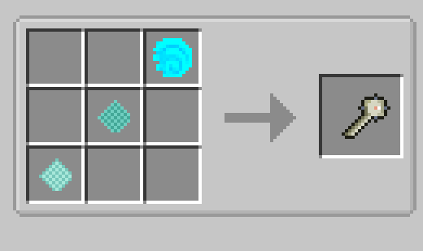 |
| <br/><a id="splendor-of-tranquil-waters"></a>**Splendor of Tranquil Waters** | <br/>Hydro | **Reach:** 16m Ousia / 6m➔8m Pneuma (30s)<br/>**Damage:** (5%–14% Max HP, up to 1.4x) + 1U Hydro / (7.5%–21% Max HP, up to 1.4x) + 1.5U Hydro<br/>**Cooldown:** 20.0s<br/>**Durability:** 140 / 500 | **Recipe:** Shaped (Slot 2/5/6: 3x Hydro Element, Slot 3: Heart of the Sea, Slot 7: **Hydro Rod**).<br/>**Ability (Furina):** **Hold Left-Click for 0.5s (Charged Attack)** (or Hold/Sneak + Right-Click) switches Arkhe (`Ousia` ↔ `Pneuma`) at any time. **Right-Click (E)** summons **Salon Solitaire** (3 Hydro companions wearing 3D top hats / tiaras that drain 2% HP above 50% Max HP for up to `1.4x` DMG) or **Singer of Many Waters** for 15s. **Press `[R]` (Burst Q — *Let the People Rejoice*, `15.0s` CD)** for **`1.6s` I-frames**, a celebratory spin animation, AoE Hydro stage damage (`2.5♥ + 12% Max HP` Basic / `3.75♥ + 18% Max HP` Netherite), and immediate **Universal Revelry Fanfare** (`+25%` / `+30%` All DMG & Healing)!<br/><br/>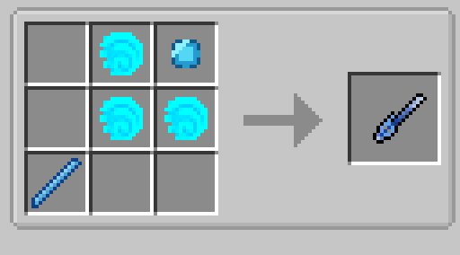 |
| <br/><a id="frostbolt-wand"></a>**Frostbolt Wand** | <br/>Cryo | **Reach:** 28m / 28m (2.0m AoE)<br/>**Damage:** 2.25♥ x 3 burst shots + 1U Cryo / 3.375♥ x 3 burst shots + 1.5U Cryo<br/>**Cooldown:** 4.0s<br/>**Durability:** 150 / 500 | **Recipe:** Shaped (Slot 3: Blue Ice, Slot 5: Cryo Element, Slot 7: **Frost Rod**).<br/>**Ability:** Fires 3 freezing orbs chilling and slowing enemies. Freezes surface water into temporary walkable frost.<br/><br/>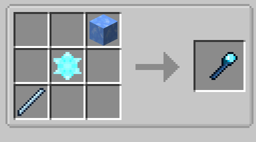 |
| <br/><a id="nights-focus-staff"></a>**Key of Khaj-Nisut (Nights of Formal Focus)** | <br/>Cryo | **Reach:** 20m (AoE / 12s Curtain of Slumber Shield)<br/>**Damage:** 2.0♥ + 4x 1.5♥ Shooting Stars / 3.0♥ + 4x 2.25♥ (Netherite)<br/>**Cooldown:** 12.0s<br/>**Durability:** 150 / 500 | **Recipe:** Shaped (Slot 3: Shield, Slot 5 & 7: 2x **Frost Rod**).<br/>**Ability (Layla):** **Right-Click (E)** forms the **Curtain of Slumber** Cryo Absorption Shield (`12s`, `40%`/`60%` Max HP, `250%` Cryo absorption) that accumulates **Night Stars** every 1.5s; at 4 stars, launches 4 homing **Shooting Stars**. **Press `[R]` (Burst Q — *Dream of the Star-Stream Shaker*, `12.0s` CD)** for **`1.6s` I-frames**, AoE Cryo starlight damage, and **4 immediate homing Shooting Stars**!<br/><br/>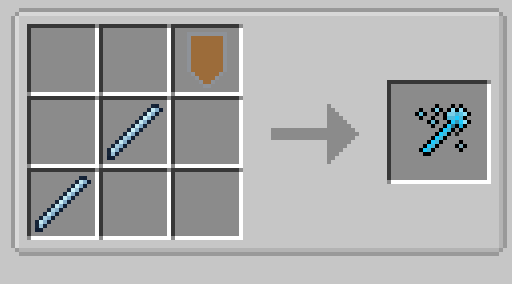 |
| <br/><a id="evoker-fang-staff"></a>**Evoker Fang Staff** | <br/>Geo | **Reach:** 13.5m (9 Fangs) / 19.5m (13 Fangs)<br/>**Damage:** 1.5♥ per fang + 1U Geo / 2.25♥ per fang + 1.5U Geo<br/>**Cooldown:** 5.0s<br/>**Durability:** 120 / 450 | **Recipe:** Shaped (Slots 1 & 3: 2x Iron Ingot, Slot 5: Geo Element, Slot 7: Blaze Rod).<br/>**Ability:** Summons a line of biting fangs and a [Geo Fang Pillar](Environmental-Interactions#3-geo-constructs-fang-pillars--stone-steles) that taunts mobs, pulses Geo waves, and **lifts you onto its top when cast while looking down**.<br/><br/>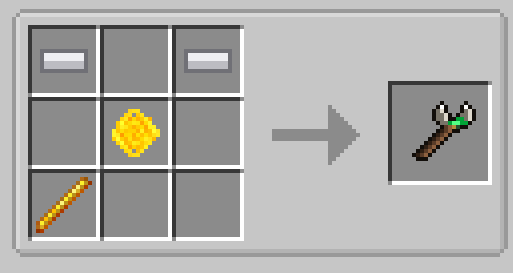 |
| 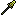<br/><a id="vortex-vanquisher"></a>**Vortex Vanquisher** | <br/>Geo | **Reach:** 12m (Max 3 Constructs, 4m Pulse) / 6.5m➔8.5m `[R]`<br/>**Damage:** (2.0♥ + 1.9% Max HP) E / 2.75♥ (+10% Bonus HP) `[R]` \| (3.0♥ + 2.85% Max HP) E / 3.75♥ (+15% Bonus HP) `[R]`<br/>**Cooldown:** 4.0s (Tap) / 12.0s (Hold 1.5s) \| 12.0s `[R]`<br/>**Durability:** 140 / 500 | **Recipe:** Shaped (Slot 3: Gold Block, Slot 5: Geo Element, Slot 7: **Geo Rod**).<br/>**Ability (Zhongli):** **Tap Right-Click (4.0s CD)** summons a **3.5-block Stone Stele** (`30s`, max 3 constructs, vertical or wall-mounted). **Hold Right-Click 1.5s (12.0s CD, mini Rubik meteor HUD icon)** forms a **Jade Shield for 20s** (`4.5♥` Basic / `6.25♥` Netherite base at 20 HP, `150%` All-DMG absorption, and **`-20%` All Elemental & Physical RES shred aura** within `4.5m`). **Press `[R]` (*Planet Befall*, 12.0s CD, `1.8s` I-frames)** to call down a giant Rubik Geo Meteor descending diagonally from behind the caster over **`2.5s`**, dealing **`2.75♥` (+10% Bonus HP) Basic / `3.75♥` (+15% Bonus HP) Netherite** AoE Geo damage, **Petrifying** enemies (`4.0s` / `5.0s`) with **skin-tight bronze-stone & glowing golden Geo vein overlays conforming 100% to each mob's 3D geometry**, and on Netherite (**C2**), **granting Jade Shields to the caster and all nearby allies within `8.5m`**!<br/><br/>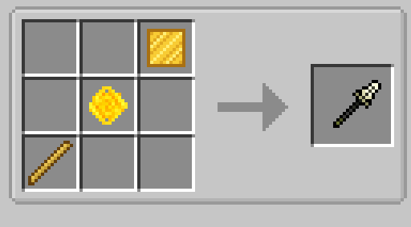 |
| <br/><a id="peak-patrol-song"></a>**Peak Patrol Song** | <br/>Geo | **Reach:** 3m Skate Lunge / 8m Source Samples (`-36%` RES) / 5m `[R]`<br/>**Damage:** 2.0♥ (E) + 1.75♥ (Kick) / 3.0♥ (E) + 2.625♥ (Kick) + 0.5♥ `[R]`<br/>**Cooldown:** 7.0s (E) / 15.0s `[R]`<br/>**Durability:** 150 / 500 | **Recipe:** Shaped (Slot 3: Geo Element, Slot 5: **Geo Rod**, Slot 7: Diamond Sword).<br/>**Ability (Xilonen — Dedicated Natlan Support for Mavuika):**<br/>• **Right-Click (E — *Yohual's Scratch*, `7.0s` CD):** Enters 3D **Geo Roller Skate Nightsoul state** (starting at **`45/90` Nightsoul pts**, lasting a full **`9.0s` Basic / `13.0s` Netherite C1**) with **`+65%` skating speed**, **release-and-repress Skate Dash** (`Sprint` or `Right-Click` with `0.5s` ICD; `Shift + Right-Click` to exit early), **high skate jump (`2.15m`) with 360° X-axis Front Flip** (high enough to trigger **Plunge Attacks** on flat ground!), and **smooth vertical wall-climbing** (`Space` to wall-leap).<br/>• **`E -> N2` Instant Nightsoul Burst:** Landing **2 normal attack kicks** (`+35` pts each $
ightarrow$ `90/90`) immediately **consumes all 90 Nightsoul points at once**, **feeds `+90` Fighting Spirit directly to Mavuika**, and activates **Source Samples (`15s`, persists off-field)** shredding **`-36%` Elemental RES** within `8m` for sampled elements in your 4-staff inventory.<br/>• **Crystallize Scroll Buff:** Triggering Crystallize grants **`+40%` Elemental DMG for `18s`** to **Geo & the reacted element**.<br/>• **Press `[R]` (*Ocelotlicue Point!*, `15.0s` CD):** Deals `0.5♥` (`1.0 HP`) AoE Geo damage to trigger Crystallize and activates **single-target self-healing for the active player only** (`1.5♥` Basic / `2.0♥` Netherite every `1.5s` for `12s` when `>= 2` PHEC samples).<br/>• **Netherite C1 + C2:** `-30%` Nightsoul drain, `+50%` Knockback Res, and **C2 Sample Buffs** (**Geo `+50%` DMG**, **Pyro `+45%` DMG**, **Hydro `+45%` Max HP**, **Electro `-6s` `[R]` CD & Energy**, **Cryo `+60%` Crit DMG**)!<br/><br/>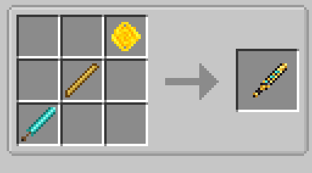 |

---

## Dendro Staves

| Staff | Element | Base & Netherite Stats | Crafting Recipe & Mechanics |
| :--- | :---: | :--- | :--- |
| <br/><a id="webcaster"></a>**Webcaster** | <br/>Dendro | **Reach:** 28m<br/>**Damage:** Trapping Web + Poison I / Trapping Web + Poison II + 1.5U Dendro<br/>**Cooldown:** 5.0s<br/>**Durability:** 140 / 500 | **Recipe:** Shaped (Slot 3: Cobweb, Slot 5: Dendro Element, Slot 7: Blaze Rod).<br/>**Ability:** Launches dense temporary webs (5s basic / 7.5s Netherite) that immobilize targets and inflict Poison.<br/><br/>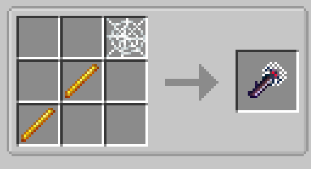 |
| <br/><a id="wither-scepter"></a>**Wither Scepter** | <br/>Dendro | **Reach:** 32m (3.0m AoE) / 32m (4.0m AoE)<br/>**Damage:** 4.0♥ x 3 burst shots + 1U Dendro + Wither I / 6.0♥ x 3 burst shots + 1.5U Dendro + Wither II<br/>**Cooldown:** 6.0s<br/>**Durability:** 140 / 500 | **Recipe:** Shaped (1 Wither Skeleton Skull + 2 Blaze Rods diagonal).<br/>**Ability:** Fires 3 Wither skulls sequentially, detonating in an area and inflicting Wither decay.<br/><br/>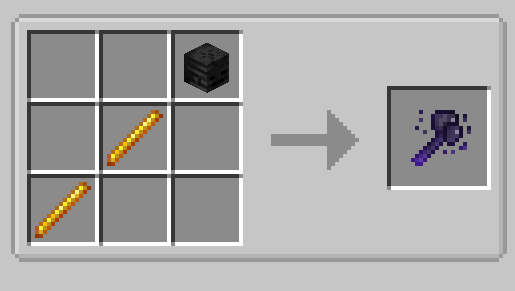 |

---

## Netherite Smithing Upgrade Process

To upgrade any basic staff to its Netherite tier:
1. Place a **Smithing Table**.
2. Slot 1: **Netherite Upgrade Smithing Template**.
3. Slot 2: **Any Basic Staff**.
4. Slot 3: **Netherite Ingot**.

<div align="center">
  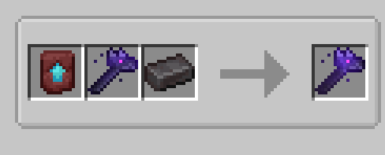
  <br/><sub><i>In-game Smithing Table UI demonstrating staff ascension to Netherite tier.</i></sub>
</div>

---

## Staff Enchantments (Elemental Mastery)

Enhance your arcane combat potential by enchanting any staff with **Elemental Mastery (EM)**. Inspired by the core stat from *Genshin Impact*, this enchantment dramatically increases reaction output, amplifying both burst multipliers and transformative damage procs.

<div align="center">
  <table>
    <tr>
      <td align="center"><b>Elemental Mastery I</b><br/>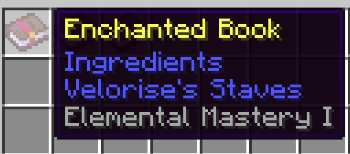</td>
      <td align="center"><b>Elemental Mastery II</b><br/>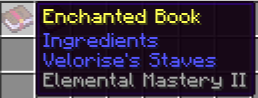</td>
      <td align="center"><b>Elemental Mastery III</b><br/>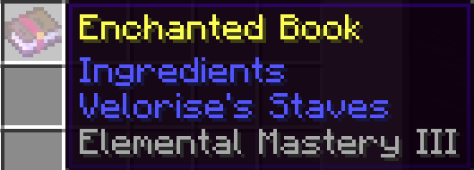</td>
    </tr>
  </table>
  <sub><i>Enchanted Books for Elemental Mastery can be obtained from Enchanting Tables, dungeon loot, or villager trading.</i></sub>
</div>

### Mechanics & Stat Scaling
* **Compatible Items:** Can be applied to **all 20 Arcane Staves**, their **Netherite Ascensions**, and the **Omni Staff**.
* **Application Methods:**
  * Direct enchantment via an **Enchanting Table** (Levels 10–30+).
  * Combining an **Enchanted Book** with your staff at an **Anvil** (Cost: 4+ XP levels).
* **Live Tooltip Display:** Holding an enchanted staff highlights the active combat bonuses in gold:
  ```text
  ✦ EM Reaction Bonus: +X% Amp / +Y% Trans / +Z% Cat
  ```
* **Advancement:** Equipping any staff imbued with this enchantment unlocks the **"Elemental Scholar"** advancement!

### Scaling Table per Enchantment Level

| Level | Amplifying Reactions (Melt, [Vaporize](Elements-and-Reactions#vaporize)) | Transformative Reactions (Overload, [Superconduct](Elements-and-Reactions#superconduct), [Swirl](Elements-and-Reactions#swirl), [Bloom](Elements-and-Reactions#bloom), [Hyperbloom](Elements-and-Reactions#hyperbloom), [Burgeon](Elements-and-Reactions#burgeon), [Shatter](Elements-and-Reactions#shatter), [Electro-Charged](Elements-and-Reactions#electro-charged), [Burning](Elements-and-Reactions#burning)) | Catalyze Reactions ([Aggravate](Elements-and-Reactions#aggravate), [Spread](Elements-and-Reactions#spread)) | [Crystallize Shield](Relics-and-Utilities#crystallize-shield-shards) HP Bonus |
|:---:|:---:|:---:|:---:|:---:|
| **Level I** | **+15%** Damage | **+30%** Damage | **+25%** Added Damage | **+1.0 HP (+0.5 ♥)** Shield HP |
| **Level II** | **+30%** Damage | **+60%** Damage | **+50%** Added Damage | **+2.0 HP (+1.0 ♥)** Shield HP |
| **Level III** | **+45%** Damage | **+90%** Damage | **+75%** Added Damage | **+3.0 HP (+1.5 ♥)** Shield HP |


---

## Armor Enchantments (Elemental Protection I–IV)

To provide dedicated defensive counterplay against high-intensity elemental spells and reactions (`velorise_staves:elemental` DamageType, which bypasses vanilla `Protection`), armor pieces (`Helmet`, `Chestplate`, `Leggings`, `Boots`) can be enchanted with **Elemental Protection I–IV** (`velorise_staves:elemental_protection`):

* **Elemental Damage Reduction:** Reduces incoming Elemental Staff & Reaction damage by **5% per level** across all 4 armor slots (up to **80% reduction** at `16` total levels / full `Elemental Protection IV` armor).
* **Aura & Freeze Duration Tenacity:** Reduces incoming elemental aura durations by **3% per total level** (up to **-60%**) and reduces **Frozen** immobilization duration by **4% per total level** (up to **-60%**).
* **Mutual Exclusivity:** Mutually exclusive with vanilla `Protection`, `Fire Protection`, `Blast Protection`, and `Projectile Protection` on the same armor piece.
