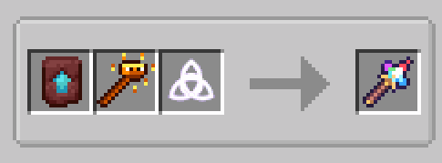

# Arcane Staves & Netherite Upgrades

**Velorise's Staves & Elements** features 15 distinct elemental staves, each channeling the power of iconic Minecraft entities and materials. Every basic staff can be upgraded at a **Smithing Table** using a **Netherite Upgrade Template** and a **Netherite Ingot** to grant dramatically increased durability, enhanced reach, **1.5x combat stats (damage, HP scaling, elemental gauge U, and effect durations) without reducing cooldowns**, and immunity to fire and lava destruction.

---

## The Apex Weapon: Omni Staff

<div align="center">
  
  &nbsp;&nbsp;&nbsp;&nbsp;&nbsp;&nbsp;
  
  <br/>
  <b>Omni Staff (Basic Tier) &nbsp;|&nbsp; Netherite Omni Staff (Ascended Tier)</b>
</div>

* **Elemental Alignment:**  Dynamic Omni (Cycles across all 7 elements).
* **Core Mechanics:**
  * Press **`[Tab]`** to open the **Radial Element Wheel** to switch your active elemental alignment instantly.
  * Fires homing prism crystals that automatically select the optimal reaction element against the target's current aura.
* **Combat Stats:**
  * **Range:** 36m (1.75m AoE) [Basic] / 48m (2.5m AoE) [Netherite]
  * **Damage:** 10.0 Hearts (20 HP) + 2U Active Element [Basic] / 15.0 Hearts (30 HP) + 3U Active Element [Netherite]
  * **Cooldown:** 6.0 seconds
  * **Durability:** 250 [Basic] / 900 [Netherite]

### Crafting Methods (Dynamic Recipe)

<div align="center">
  
  <br/><sub><i>In-Game Recipe Showcase: Alternating between Crafting Table and Smithing Table recipes.</i></sub>
</div>

<details open>
<summary><b>Method 1: Crafting Table (Shapeless - 7 Staves)</b></summary>

Combine 1 staff from each of the 7 elemental groups (`pyro_staves`, `hydro_staves`, `cryo_staves`, `electro_staves`, `dendro_staves`, `anemo_staves`, `geo_staves`) anywhere in a Crafting Table:

<div align="center">
  
</div>
</details>

<details>
<summary><b>Method 2: Smithing Table (Omni Element Transformation)</b></summary>

Combine a **Netherite Upgrade Template** + **Any Basic Elemental Staff** +  [**Omni Element**](Relics-and-Utilities#omni-element) in a Smithing Table:

<div align="center">
  
</div>
</details>

<br/>

<div align="center">
  
</div>

---

## Electro Staves

| Staff | Element | Base & Netherite Stats | Crafting Recipe & Mechanics |
| :--- | :---: | :--- | :--- |
| <br/><a id="dragonfire-scepter"></a>**Dragonfire Scepter** | <br/>Electro | **Reach:** 32m (3.5m AoE) / 32m (4.5m AoE)<br/>**Damage:** 3.5♥ (7.0 HP) + Cloud + 2U Electro / 5.25♥ (10.5 HP) + Cloud + 3U Electro<br/>**Cooldown:** 8.0s<br/>**Durability:** 130 / 500 | **Recipe:** Shaped (1 Dragon Head + 2 Blaze Rods diagonal).<br/>**Ability:** Hurls dragon breath leaving an electrified cloud that electrifies water and shocks enemies.<br/><br/> |
| <br/><a id="shulker-seeker"></a>**Shulker Seeker** | <br/>Electro | **Reach:** 30m<br/>**Damage:** 4.0♥ x 2 burst shots + 1U Electro / 6.0♥ x 2 burst shots + 1.5U Electro<br/>**Cooldown:** 5.0s<br/>**Durability:** 130 / 500 | **Recipe:** Shaped (1 Shulker Shell + 2 End Rods diagonal).<br/>**Ability:** Shoots 2 homing Shulker bullets that track moving targets and inflict Levitation (3s / 4s).<br/><br/> |
| <br/><a id="arc-caster"></a>**Arc Caster** | <br/>Electro | **Reach:** 30m Arc (Single Target) / 36m Arc (6.0m Chain)<br/>**Damage:** 0.5♥ per hit + 1U Electro / 0.75♥ per hit + 1.5U Electro (Channeled, 12 hits)<br/>**Cooldown:** 6.0s<br/>**Durability:** 130 / 500 | **Recipe:** Shaped (1 Electro Element + 2 Amethyst Shards diagonal).<br/>**Ability:** Channeled voltaic arc stream (3.0s). Chains to nearby mobs on Netherite tier.<br/><br/> |

---

## Anemo Staves

| Staff | Element | Base & Netherite Stats | Crafting Recipe & Mechanics |
| :--- | :---: | :--- | :--- |
| <br/><a id="resonant-echo"></a>**Resonant Echo** | <br/>Anemo | **Reach:** 28m / 32m<br/>**Damage:** 5.5♥ (11.0 HP) + 2U Anemo ([Swirl](Elements-and-Reactions#swirl)) / 8.25♥ (16.5 HP) + 3U Anemo (Swirl)<br/>**Cooldown:** 8.0s<br/>**Durability:** 130 / 500 | **Recipe:** Shaped (1 Calibrated Sculk Sensor + 2 Echo Shards diagonal).<br/>**Ability:** Charged attack (1.5s charge). Channels a piercing Warden sonic boom that penetrates walls and triggers Swirl.<br/><br/> |
| <br/><a id="wind-staff"></a>**Wind Staff** | <br/>Anemo | **Reach:** 28m (3.5m AoE) / 28m (4.5m AoE)<br/>**Damage:** 0.75♥ (1.5 HP) + 1U Anemo ([Swirl](Elements-and-Reactions#swirl)) / 1.125♥ (2.25 HP) + 1.5U Anemo (Swirl)<br/>**Cooldown:** 1.5s<br/>**Durability:** 140 / 500 | **Recipe:** Shaped (1 Wind Charge + 2 Breeze Rods diagonal).<br/>**Ability:** Rapid gust charge. Firing at the ground executes a **Wind-Jump** launch on the caster.<br/><br/> |

---

## Pyro Staves

| Staff | Element | Base & Netherite Stats | Crafting Recipe & Mechanics |
| :--- | :---: | :--- | :--- |
| <br/><a id="inferno-rod"></a>**Inferno Rod** | <br/>Pyro | **Reach:** 30m<br/>**Damage:** 3.0♥ x 3 burst shots + 1U Pyro / 4.5♥ x 3 burst shots + 1.5U Pyro<br/>**Cooldown:** 4.0s<br/>**Durability:** 150 / 550 | **Recipe:** Shaped (1 Fire Charge + 2 Blaze Rods diagonal).<br/>**Ability:** Fires 3 rapid-fire Blaze fireballs sequentially, setting struck entities on fire.<br/><br/> |
| <br/><a id="ghastfire-staff"></a>**Ghastfire Staff** | <br/>Pyro | **Reach:** 36m (3.5m AoE / 5s Field) / 36m (4.5m AoE / 5s Field)<br/>**Damage:** 3.0♥ (6.0 HP) + 2U Pyro / 4.5♥ (9.0 HP) + 3U Pyro<br/>**Cooldown:** 5.0s<br/>**Durability:** 120 / 450 | **Recipe:** Shaped (Slot 3: Pyro Element, Slot 5: Ghast Tear, Slot 7: Blaze Rod).<br/>**Ability:** Charged attack (2.0s charge). Launches an explosive Ghast fireball leaving a 5-second lingering Ghastfire field.<br/><br/> |

---

## Hydro, Cryo & Geo Staves

| Staff | Element | Base & Netherite Stats | Crafting Recipe & Mechanics |
| :--- | :---: | :--- | :--- |
| <br/><a id="guardian-lens"></a>**Guardian Lens** | <br/>Hydro | **Reach:** 24m / 28m<br/>**Damage:** (10% to 20% user Max HP) x 8 hits (3.0s continuous beam) + 1U Hydro / (15% to 30% Max HP) x 8 hits (3.0s) + 1.5U Hydro<br/>**Cooldown:** 5.0s<br/>**Durability:** 130 / 500 | **Recipe:** Shaped (1 Hydro Element + 1 Prismarine Shard + 1 Prismarine Crystals diagonal).<br/>**Ability (Neuvillette Rework):** Triggering Hydro reactions spawns **Sourcewater Droplets** (max 6). Holding Right-Click absorbs up to 3 **creator-owned** droplets (each healing **16% Max HP**, up to **48% Max HP**) to **instantly unleash** a **3.0-second piercing *Equitable Judgment* torrent beam** that pierces through all enemies in a straight line (8 hits, 1 hit every 0.4s). Drains **8% Max HP every 0.5s** (up to 48% Max HP over 3s) and **automatically stops draining at <= 50% Max HP** while continuing to fire normally, and scales with **Past Draconic Glories** (`1.15x / 1.30x / 1.60x` for 1/2/3 distinct Hydro reactions) & [Hydro Resonance](Elements-and-Reactions#elemental-resonance-system-all-8-resonances) (+25% Max HP)!<br/><br/> |
| <br/><a id="splendor-of-tranquil-waters"></a>**Splendor of Tranquil Waters** | <br/>Hydro | **Reach:** 16m Ousia / 6m➔8m Pneuma (30s)<br/>**Damage:** (5%–14% Max HP, up to 1.4x) + 1U Hydro / (7.5%–21% Max HP, up to 1.4x) + 1.5U Hydro<br/>**Cooldown:** 20.0s<br/>**Durability:** 140 / 500 | **Recipe:** Shaped (Slot 3: Heart of the Sea, Slots 2/5/6: 3x Hydro Element, Slot 7: End Rod).<br/>**Ability (Furina Reference):** **Hold Right-Click for 0.5s (Charged Attack)** (or Sneak + Right-Click) switches Arkhe alignment (`Ousia` ↔ `Pneuma`) at any time (even during cooldown, immediately transforming active summons on the field). **Tap Right-Click** summons **Salon Solitaire** (3 Hydro companions that naturally roam the world and silently drain 2% HP from up to 4 allies above 50% Max HP for up to `1.4x` DMG) or **Singer of Many Waters** (heals **1.0 ♥ every 2.0s** on Basic / scales with Max HP on Netherite) for 30s. Grants smooth surface **Water Walking** while active, stacks **Fanfare** on HP fluctuations (up to **+25% / +30% All DMG & Incoming Healing**), and features **custom First-Person & Third-Person Furina animations** (Summon: one hand plants the scepter into the ground while the other raises skyward; Arkhe Switch: plants the scepter straight down)! |
| <br/><a id="frostbolt-wand"></a>**Frostbolt Wand** | <br/>Cryo | **Reach:** 28m / 28m (2.0m AoE)<br/>**Damage:** 3.0♥ x 3 burst shots + 1U Cryo / 4.5♥ x 3 burst shots + 1.5U Cryo<br/>**Cooldown:** 4.0s<br/>**Durability:** 150 / 500 | **Recipe:** Shaped (Slot 3: Blue Ice, Slot 5: Cryo Element, Slot 7: Blaze Rod).<br/>**Ability:** Fires 3 freezing orbs chilling and slowing enemies. Freezes surface water into temporary walkable frost.<br/><br/> |
| <br/><a id="evoker-fang-staff"></a>**Evoker Fang Staff** | <br/>Geo | **Reach:** 13.5m (9 Fangs) / 19.5m (13 Fangs)<br/>**Damage:** 3.0♥ per fang + 1U Geo / 4.5♥ per fang + 1.5U Geo<br/>**Cooldown:** 5.0s<br/>**Durability:** 120 / 450 | **Recipe:** Shaped (1 Totem of Undying + 2 Blaze Rods diagonal).<br/>**Ability:** Summons a line of biting fangs and a [Geo Fang Pillar](Environmental-Interactions#3-geo-constructs-fang-pillars--stone-steles) (`1x1x1`, `1x Max HP` Basic / `1x2x1`, `2x Max HP` Netherite) that taunts mobs, pulses Geo waves, and **lifts you onto its top when cast while looking down**.<br/><br/> |
| <br/><a id="vortex-vanquisher"></a>**Vortex Vanquisher** | <br/>Geo | **Reach:** 12m (Max 3 Constructs, 4m Pulse)<br/>**Damage:** (2.0♥ + 1.9% Max HP) + 1U Geo / (3.0♥ + 2.85% Max HP) + 1.5U Geo<br/>**Cooldown:** 4.0s (Tap) / 12.0s (Hold 1.5s)<br/>**Durability:** 140 / 500 | **Recipe:** Shaped (1 Gold Block + 1 Geo Element + 1 Blaze Rod diagonal).<br/>**Ability (Zhongli Reference):** **Tap Right-Click (4.0s CD)** summons a **3.5-block-tall Stone Stele** for **30s** (shares the default **max 3 Geo Constructs** cap; places vertically on ground or **horizontally protruding from a wall** when aiming at a block's side face; does not taunt mobs; pulses `4m` resonant Geo waves every 2s, supports standing in water across all loaders, settles onto ground or stacks atop existing Geo Constructs to unlock **Solidify!**). **Hold Right-Click 1.5s (12.0s CD)** forms a compact neck-to-knee **Jade Shield for 20s** (`150%` absorption efficiency against all Elemental & Physical DMG, `-20%` All Elemental & Physical RES aura within `4.5m`, **+20% Basic / +30% Netherite Golden Majesty DMG** while shielded, summons 1 Stone Stele if below the 3-construct cap, and features **custom First-Person & Third-Person Zhongli animations** (Hold: brings both hands together in front of the chest, then sweeps both arms wide outward on Jade Shield release)! |

---

## Dendro Staves

| Staff | Element | Base & Netherite Stats | Crafting Recipe & Mechanics |
| :--- | :---: | :--- | :--- |
| <br/><a id="webcaster"></a>**Webcaster** | <br/>Dendro | **Reach:** 28m<br/>**Damage:** Trapping Web + Poison I / Trapping Web + Poison II + 1.5U Dendro<br/>**Cooldown:** 5.0s<br/>**Durability:** 140 / 500 | **Recipe:** Shaped (Slot 3: Cobweb, Slot 5: Dendro Element, Slot 7: Blaze Rod).<br/>**Ability:** Launches dense temporary webs (5s basic / 7.5s Netherite) that immobilize targets and inflict Poison.<br/><br/> |
| <br/><a id="wither-scepter"></a>**Wither Scepter** | <br/>Dendro | **Reach:** 32m (3.0m AoE) / 32m (4.0m AoE)<br/>**Damage:** 4.0♥ x 3 burst shots + 1U Dendro + Wither I / 6.0♥ x 3 burst shots + 1.5U Dendro + Wither II<br/>**Cooldown:** 6.0s<br/>**Durability:** 140 / 500 | **Recipe:** Shaped (1 Wither Skeleton Skull + 2 Blaze Rods diagonal).<br/>**Ability:** Fires 3 Wither skulls sequentially, detonating in an area and inflicting Wither decay.<br/><br/> |

---

## Netherite Smithing Upgrade Process

To upgrade any basic staff to its Netherite tier:
1. Place a **Smithing Table**.
2. Slot 1: **Netherite Upgrade Smithing Template**.
3. Slot 2: **Any Basic Staff**.
4. Slot 3: **Netherite Ingot**.

<div align="center">
  
  <br/><sub><i>In-game Smithing Table UI demonstrating staff ascension to Netherite tier.</i></sub>
</div>

---

## Staff Enchantments (Elemental Mastery)

Enhance your arcane combat potential by enchanting any staff with **Elemental Mastery (EM)**. Inspired by the core stat from *Genshin Impact*, this enchantment dramatically increases reaction output, amplifying both burst multipliers and transformative damage procs.

<div align="center">
  <table>
    <tr>
      <td align="center"><b>Elemental Mastery I</b><br/></td>
      <td align="center"><b>Elemental Mastery II</b><br/></td>
      <td align="center"><b>Elemental Mastery III</b><br/></td>
    </tr>
  </table>
  <sub><i>Enchanted Books for Elemental Mastery can be obtained from Enchanting Tables, dungeon loot, or villager trading.</i></sub>
</div>

### Mechanics & Stat Scaling
* **Compatible Items:** Can be applied to **all 15 Arcane Staves**, their **Netherite Ascensions**, and the **Omni Staff**.
* **Application Methods:**
  * Direct enchantment via an **Enchanting Table** (Levels 10–30+).
  * Combining an **Enchanted Book** with your staff at an **Anvil** (Cost: 4+ XP levels).
* **Live Tooltip Display:** Holding an enchanted staff highlights the active combat bonuses in gold:
  ```text
  ✦ EM Reaction Bonus: +X% Amp / +Y% Trans / +Z% Cat
  ```
* **Advancement:** Equipping any staff imbued with this enchantment unlocks the **"Elemental Scholar"** advancement!

### Scaling Table per Enchantment Level

| Level | Amplifying Reactions (Melt, [Vaporize](Elements-and-Reactions#vaporize)) | Transformative Reactions (Overload, [Superconduct](Elements-and-Reactions#superconduct), [Swirl](Elements-and-Reactions#swirl), [Bloom](Elements-and-Reactions#bloom), [Hyperbloom](Elements-and-Reactions#hyperbloom), [Burgeon](Elements-and-Reactions#burgeon), [Shatter](Elements-and-Reactions#shatter), [Electro-Charged](Elements-and-Reactions#electro-charged), [Burning](Elements-and-Reactions#burning)) | Catalyze Reactions ([Aggravate](Elements-and-Reactions#aggravate), [Spread](Elements-and-Reactions#spread)) | [Crystallize Shield](Relics-and-Utilities#crystallize-shield-shards) HP Bonus |
|:---:|:---:|:---:|:---:|:---:|
| **Level I** | **+15%** Damage | **+30%** Damage | **+25%** Added Damage | **+1.0 HP (+0.5 ♥)** Shield HP |
| **Level II** | **+30%** Damage | **+60%** Damage | **+50%** Added Damage | **+2.0 HP (+1.0 ♥)** Shield HP |
| **Level III** | **+45%** Damage | **+90%** Damage | **+75%** Added Damage | **+3.0 HP (+1.5 ♥)** Shield HP |


---

## Armor Enchantments (Elemental Protection I–IV)

To provide dedicated defensive counterplay against high-intensity elemental spells and reactions (`velorise_staves:elemental` DamageType, which bypasses vanilla `Protection`), armor pieces (`Helmet`, `Chestplate`, `Leggings`, `Boots`) can be enchanted with **Elemental Protection I–IV** (`velorise_staves:elemental_protection`):

* **Elemental Damage Reduction:** Reduces incoming Elemental Staff & Reaction damage by **5% per level** across all 4 armor slots (up to **80% reduction** at `16` total levels / full `Elemental Protection IV` armor).
* **Aura & Freeze Duration Tenacity:** Reduces incoming elemental aura durations by **3% per total level** (up to **-60%**) and reduces **Frozen** immobilization duration by **4% per total level** (up to **-60%**).
* **Mutual Exclusivity:** Mutually exclusive with vanilla `Protection`, `Fire Protection`, `Blast Protection`, and `Projectile Protection` on the same armor piece.
