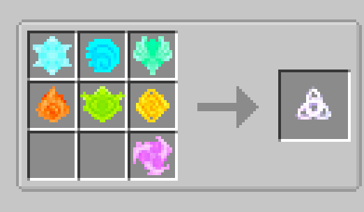

# Anvil Imbuing, Omni Staff Crafting & Repair Rules

The vanilla **Anvil** (`SwordImbueHelper`) serves as the arcane smithing station for imbuing melee swords, customizing the **Omni Staff**, and repairing staves.

---

## ⚔️ 1. Elemental Sword Imbuing (Any `SwordItem`)

Place any vanilla or modded **Sword** in the **Left Anvil Slot** and any **Elemental Essence** (`pyro_element`..`geo_element` or `omni_element`) in the **Right Anvil Slot**:
- **Cost:** `3 XP Levels` (`1 Essence` consumed).
- **Preserves Everything:** Keeps the sword's custom name, durability, Netherite tier, and all existing Enchantments (Sharpness, Looting, Fire Aspect, Mending, etc.).
- **Combat Mechanics (`applyImbuedSwordHit`):**
  - Swinging at **full attack charge (`>= 90%` attack indicator)** infuses the strike with **`1.0U` of the imbued Element** (or **Auto-Best Reaction Element** if imbued with `omni_element`!) and triggers full **Elemental Gauge Theory (EGT)** reactions!
  - **Exempt from 4-Staff Cap:** Imbued Swords do **not** count toward the `max_staves_in_inventory` limit and do **not** trigger Elemental Overload.
  - **Re-Imbuing:** You can overwrite an existing sword's imbued element at any time by combining it with a different Elemental Essence in the Anvil.

---

## 🌈 2. Omni Staff Crafting, Absorption & The 7 Archons Rule

The **Omni Staff** (`omni_staff` / `netherite_omni_staff`) is a modular master weapon that stores **one absorbed weapon per Element (`Pyro, Hydro, Anemo, Electro, Dendro, Cryo, Geo`)**.

### How to Craft an Omni Element (`omni_element`)
Combine all **7 Elemental Essences** (*Cryo, Hydro, Anemo, Pyro, Dendro, Geo, Electro*) in a Shapeless Crafting Table recipe:

### How to Create an Omni Staff
1. **Method A — Crafting Table (`recipe/omni_staff.json`):**
   - Combine **1 Non-Archon Staff from each of the 7 elemental tags** (`#pyro_staves`, `#hydro_staves`, `#anemo_staves`, `#electro_staves`, `#dendro_staves`, `#cryo_staves`, `#geo_staves`) + **1 Diamond Sword** (`S`).
   - The resulting Omni Staff **records the exact staff ID used in each elemental slot** and sets its **Max Durability to the sum of all 7 input staves' durabilities**!
2. **Method B — Anvil Direct Conversion (`Staff + Omni Element`):**
   - Place any **Non-Archon Staff** in the Left Anvil Slot and `1` **Omni Element** (`omni_element`) in the Right Slot (`5 XP Levels`).
   - Converts the staff into an **Omni Staff** (or **Netherite Omni Staff** if the base staff was Netherite!), keeping all Enchantments and placing that staff into its corresponding elemental slot (while filling the other 6 slots with default elemental staves).

### Swapping Absorbed Weapons in the Anvil (`Omni Staff + Non-Archon Staff / Trident / Void Translocator`)
Place an **Omni Staff** in the Left Anvil Slot and any eligible weapon in the Right Slot (`2 XP Levels`):
- **Pyro Slot:** *Inferno Rod* or *Ghastfire Staff*
- **Hydro Slot:** *Guardian Lens (Neuvillette)* or **Vanilla Trident (`minecraft:trident`)** (throws a loyal Riptide/Channeling Hydro Trident when locked to Hydro!)
- **Anemo Slot:** *Wind Staff* or *Resonant Echo*
- **Electro Slot:** *Arc Caster*, *Dragonfire Scepter*, *Shulker Seeker*, or **Void Translocator** (blinks through walls when locked to Electro!)
- **Dendro Slot:** *Wither Scepter* or *Webcaster*
- **Cryo Slot:** *Frostbolt Wand* or *Nights of Formal Focus (Layla)*
- **Geo Slot:** *Evoker Fang Staff* or *Peak Patrol Song (Xilonen)*

> [!CAUTION]
> **Why Can't the 7 Archon Weapons Be Combined into the Omni Staff?**
> By design (`ArcaneStaffItem.isArchonKind()`), the **7 Archon Signature Weapons** — **Mavuika** (*A Thousand Blazing Suns*), **Furina** (*Splendor of Tranquil Waters*), **Zhongli** (*Vortex Vanquisher*), **Venti** (*The Daybreak Chronicles*), **Raiden Shogun** (*Engulfing Lightning*), **Nahida** (*A Thousand Floating Dreams*), and **The Tsaritsa** (*Absolution of the Rime-Throne*) — possess multi-input Divine Authority kits (`Left-Click`, `Hold Left-Click`, `Tap Right-Click`, `Hold Right-Click`, `[R] Burst`, Stance Switches, and Vehicles) that cannot be compressed into a single Omni Wheel slot. Both the Crafting Table tags (`*_staves.json`) and Anvil logic (`!staff.isArchon()`) strictly reject Archon weapons from being absorbed into the Omni Staff.

---

## 🔧 3. Anvil Repairing
- **Matching Essence Repair:** Place any combat staff (including Archon weapons!) in the Left Anvil Slot and its **matching Elemental Essence** in the Right Slot — each essence restores **25% of the staff's Max Durability** (`1 XP Level` per essence).
- **Universal Omni Repair:** An **Omni Element** (`omni_element`) can repair **any** staff or relic (including the Omni Staff and all 7 Archon weapons) for **50% Max Durability** per essence!
